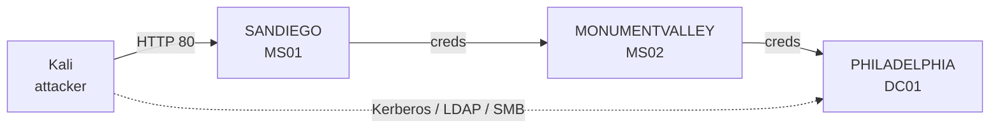

# Steel Ball Run — Active Directory Pentest Lab

> *"The race begins at San Diego Beach. Whoever reaches New York first wins fifty million dollars."*

An OSCP-style Active Directory attack lab, themed around *JoJo's Bizarre Adventure Part 7: Steel Ball Run*. Three Windows Server VMs form the `steelballrun.local` domain. You start with no credentials and only network access. You have to chain web exploitation, Windows privilege escalation, Kerberos attacks and AD ACL abuse to take over the Domain Controller.

Everything is built by PowerShell scripts, so the lab can be rebuilt from scratch in about an hour.

> [!WARNING]
> This lab is **intentionally vulnerable**. Run it only on an isolated host-only network, never on a network you don't own, and never expose it to the internet. Microsoft Defender is removed from every VM.

---

## Lab Overview

| Role | Hostname | IP (default) | OS | Theme |
|------|----------|--------------|----|-------|
| Domain Controller | `PHILADELPHIA` | 192.168.56.10 | Windows Server 2022 | The President's seat of power |
| Member server (MS01) | `SANDIEGO` | 192.168.56.11 | Windows Server 2022 + IIS | Race start: public registration office |
| Member server (MS02) | `MONUMENTVALLEY` | 192.168.56.12 | Windows Server 2022 | 1st stage checkpoint: telemetry server |
| Attacker | Kali Linux | 192.168.56.50 | Kali (any recent) | You |

- **Domain:** `steelballrun.local` (NetBIOS `SBR`)
- **Goal:** collect `local.txt` / `proof.txt` from every machine and become Domain Admin.
- **Difficulty:** intermediate (OSCP AD set level).



## Skills Practiced

The exact chain is in the [answer key](docs/ANSWER-KEY.md). These are the techniques it covers:

| Phase | Technique | MITRE ATT&CK |
|-------|-----------|--------------|
| Initial access | Unrestricted file upload → ASPX web shell | T1190, T1505.003 |
| Privilege escalation | `SeImpersonatePrivilege` abuse (Potato) | T1134.001 |
| Credential access | LSA secrets / autologon credentials | T1003.004 |
| Credential access | Kerberoasting + offline cracking | T1558.003 |
| Lateral movement | WinRM with domain credentials | T1021.006 |
| Privilege escalation | Weak service permissions (binPath hijack) | T1574.011 |
| Credential access | Credentials in files | T1552.001 |
| Domain escalation | AD ACL abuse (GenericAll → WriteDACL) | T1222.001 |
| Domain escalation | DCSync | T1003.006 |
| Lateral movement | Pass-the-Hash | T1550.002 |

It also includes a few red herrings, such as an AS-REP-roastable account, a second roastable SPN and a disabled account. Not everything that looks juicy is the way forward.

## Repository Layout

```
steel-ball-run-ad-lab/
├── README.md                    ← you are here
├── docs/
│   ├── SETUP.md                 ← building the lab (VMs, network, scripts)
│   ├── SCENARIO.md              ← the engagement brief for players
│   ├── HINTS.md                 ← progressive, spoiler-tagged hints
│   └── ANSWER-KEY.md            ← full walkthrough (spoilers!)
└── scripts/
    ├── LabConfig.psd1           ← IPs, names, passwords (edit network here)
    ├── LabCommon.ps1            ← shared helpers
    ├── DC01-1-Promote.ps1       ← DC: IP, rename, promote forest
    ├── DC01-2-Configure.ps1     ← DC: users, groups, SPNs, ACLs, flag
    ├── Member-1-JoinDomain.ps1  ← MS01/MS02: IP, rename, domain join
    ├── MS01-2-Configure.ps1     ← SANDIEGO: IIS app, autologon, flags
    ├── MS02-2-Configure.ps1     ← MONUMENTVALLEY: service, WinRM, flags
    └── web/                     ← race registration website (deployed to MS01)
```

## Quick Start

1. Create three Windows Server 2022 VMs ([free evaluation ISO](https://www.microsoft.com/en-us/evalcenter/download-windows-server-2022)) and one [Kali](https://www.kali.org/get-kali/) VM on the same host-only network.
2. Copy the `scripts/` folder to `C:\LabSetup` on each Windows VM.
3. Run the scripts in order:

| Step | VM | Command (elevated PowerShell) |
|------|----|------------------------------|
| 1 | DC01 | `.\DC01-1-Promote.ps1` (run twice; it reboots in between) |
| 2 | DC01 | `.\DC01-2-Configure.ps1` |
| 3 | MS01 | `.\Member-1-JoinDomain.ps1 -Role MS01` |
| 4 | MS02 | `.\Member-1-JoinDomain.ps1 -Role MS02` |
| 5 | MS01 | `.\MS01-2-Configure.ps1` |
| 6 | MS02 | `.\MS02-2-Configure.ps1` |

4. Each `*-2-Configure.ps1` script **deletes `C:\LabSetup` (it holds every password) and reboots** when it finishes. Use `-KeepSetupFiles` while testing. On MS01/MS02, only ever log on as the **local** `.\Administrator` ([why](docs/SETUP.md#credential-hygiene)). Then snapshot all VMs.
5. Read [SCENARIO.md](docs/SCENARIO.md) and start hacking from Kali.

The full instructions, including VM sizing, hypervisor networking and troubleshooting, are in **[docs/SETUP.md](docs/SETUP.md)**.

## Documentation

- **[SETUP.md](docs/SETUP.md)**: build the environment.
- **[SCENARIO.md](docs/SCENARIO.md)**: the engagement brief, scope, rules and scoring.
- **[HINTS.md](docs/HINTS.md)**: nudges when you're stuck.
- **[ANSWER-KEY.md](docs/ANSWER-KEY.md)**: the complete attack path with commands. ⚠️ Spoilers.

## Disclaimer

This project is for **education and authorized testing only**. The techniques here must only be used against systems you own or are explicitly authorized to test. The author is not responsible for misuse.

*Steel Ball Run* and *JoJo's Bizarre Adventure* are the property of Hirohiko Araki / Shueisha. This is a non-commercial fan-themed training lab. No artwork or copyrighted text from the series is included.
